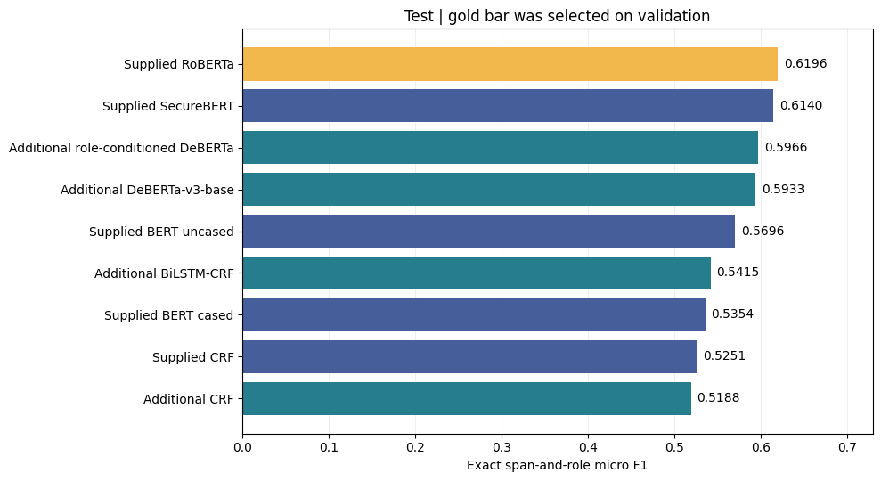

# CASIE Event Argument Extraction

**Team Ultron · NLP Project 2**

Given a cybersecurity news article, an event subtype and its trigger, identify
the event's argument spans and assign semantic roles such as Attacker, Victim
and Vulnerability. The benchmark uses **gold triggers and subtypes**, with
exact event-specific span-and-role scoring over **26 roles**.

This repository contains the executed submission, portable inputs, model and
evaluation code, benchmark tables, figures, reports, and an interactive demo.
The demo demonstrates the **validation-selected RoBERTa** model. The full
benchmark comparison is available in the notebook and results tables.

## Start here

- [Executed submission notebook](notebooks/CASIE_Project2_Executed_Submission.ipynb)
  — includes the recorded training and evaluation outputs.
- [Benchmark and limitations](BENCHMARK.md) — scoring, selection rule and provenance.
- [Dataset preparation](DATASET_PREPARATION.md) — split, alignment and checksums.
- [Demo instructions](demo/README.md) — checkpoint requirements and launch commands.
- [Reports](reports/README.md) — original reports and subsequent verification.
- [Project status](docs/PROJECT_STATUS.md) — completed checks and remaining work.
- [Contributions](contributions/CONTRIBUTIONS.md) — workstreams and artifact provenance.

## Results

Models were selected by validation Arg-C micro F1. The corrected split has
799 training, 100 validation and 100 test documents. Test evaluation covers
736 events and 2,109 gold arguments.

| Model / run | Validation F1 | Test F1 | Result source |
|---|---:|---:|---|
| **RoBERTa** | **0.6189** | **0.6196** | Supplied predictions; selected model |
| SecureBERT | 0.6183 | 0.6140 | Supplied predictions |
| DeBERTa-v3-base | 0.5987 | 0.5933 | Additional run |
| Role-conditioned DeBERTa | 0.5838 | 0.5966 | Additional run |
| BERT uncased | 0.5557 | 0.5696 | Supplied predictions |
| BiLSTM-CRF | 0.5535 | 0.5415 | Additional run |
| BERT cased | 0.5261 | 0.5354 | Supplied predictions |
| CRF, additional | 0.5075 | 0.5188 | Additional run |
| CRF, supplied | — | 0.5251 | Supplied test predictions |

There are **eight validation configurations and nine test rows** because the
supplied CRF has no validation prediction file and the test table includes
both CRF runs. The rows are not nine distinct model families. Classical CRF,
BiLSTM-CRF, general pretrained transformers, and domain-adapted SecureBERT
are compared; role conditioning is a DeBERTa formulation variant.

Full precision, recall, macro F1 and 95% document-bootstrap intervals are in
[validation_summary.csv](results/validation_summary.csv) and
[test_summary.csv](results/test_summary.csv). These historical benchmark
values remain unchanged by the later verification runs.



## Verification added after the submission run

- **BERT significance:** uncased improves over cased by **3.43 F1 points**.
  A paired document bootstrap gives a 95% difference interval of **+1.25 to
  +5.56 points**; a separate two-sided document randomization test gives
  **p = 0.0036** (100,000 samples/randomizations, seed 42). The archived
  5,000-sample bootstrap-tail calculation also reproduces 0.002. See the
  [audit and exact method](reports/verification/bert_significance.md).
- **Restored checkpoints:** RoBERTa and standard DeBERTa both load and run
  inference with the repository code. Full CPU test scoring succeeds without
  scorer warnings. CPU F1 is **0.618787** for RoBERTa and **0.592784** for
  DeBERTa; these closely reproduce, but do not exactly match, the historical
  **0.619557** and **0.593252**. See the
  [checkpoint verification](reports/verification/checkpoint_cpu_verification.md).
- **DeBERTa GPU verification remains pending.** The
  [Colab verification notebook](notebooks/CASIE_Colab_DeBERTa_Verification.ipynb)
  compares new GPU predictions with the recorded CPU file, without training.
  [Step-by-step instructions](reports/verification/colab_deberta_verification.md)
  describe the required private inputs and downloadable result archive.

The BERT comparison concerns two fitted models with different pretrained
weights and vocabularies; it does not isolate a causal effect of casing.
Document-bootstrap intervals do not measure variation across training seeds.

## Run the demo

The interface loads **one fine-tuned model at a time**. Its five event-type
choices are not five model choices. Automatic trigger candidates come from a
training-derived lexicon; a manual trigger option is also available.

Use an environment matching [requirements.txt](requirements.txt), with the
PyTorch CPU/CUDA build appropriate to the machine. The recorded local checks
used Python 3.13, CPU PyTorch 2.11.0, Transformers 5.21.0 and Gradio 6.31.0.

```bash
python -m venv .venv
# Activate .venv using your shell, then:
python -m pip install -r requirements.txt
python demo/launch.py --checkpoint runs/roberta_base_muhammet --model-label RoBERTa
```

The checkpoint path is an example: first obtain the complete fine-tuned
checkpoint from the team and place it under ignored `runs/`. A fresh clone
does **not** include weights. A base pretrained model is not a substitute.
The launcher prints the local demo URL. Add `--lexicon PATH` to use a separate
lexicon, or explicitly add `--share` for a temporary public Gradio link.

Standard DeBERTa can be launched instead with its restored checkpoint and
`--model-label DeBERTa-v3-base`. CRF, BiLSTM-CRF and role-conditioned DeBERTa
require their own inference paths; they are not supported by this launcher.
See [demo/README.md](demo/README.md) for details and limitations.

## Reproduce the BERT audit without checkpoints

This analysis uses the supplied prediction artifacts and the repository's
exact scorer. It does not run model inference or training and uses only the
Python standard library plus `team_code/casie_eval.py`.

```bash
python scripts/verify_bert_significance.py --repo . --out runs/bert_significance_rerun
python -m unittest discover -s tests -v
python scripts/check_repository.py
```

The audit output directory must be new. Its recorded output and per-document
count triples are under [results/verification/](results/verification/).

## Repository layout

```text
notebooks/       Executed submission and unexecuted GPU verification notebook
data/            Portable input ZIP: corrected splits, metadata, supplied predictions
team_code/       Shared scorer, standard models, demo and role-conditioned method
demo/            Portable launcher, documented usage and original trigger lexicon
results/         Historical tables/manifest, verification results and latency evidence
figures/         Final figures exported from executed notebook outputs
reports/         Original PDF reports and current verification notes
presentation/    Existing presentation; professor-feedback revision still pending
contributions/   Workstream provenance; personal attribution awaits team confirmation
scripts/         BERT audit and repository validation commands
tests/           Lightweight launcher regression checks
runs/            Local checkpoints, predictions and caches (ignored; not distributed)
```

Keep `team_code/` at the repository root: the notebook and demo depend on it.
The executed submission, input bundle, historical CSVs and final figures are
preserved. Generated caches, local environments, checkpoint weights and
temporary uploads are excluded from Git.

## Interpretation and references

The benchmark's 0.6196 F1 applies to argument extraction with **gold triggers**.
The raw-text demo's automatic trigger-to-argument F1 has not been measured.
It may miss or propose incorrect triggers. The original team test results
were visible before the additional experiments, so this is not a fully blind
test comparison. New CPU/GPU discrepancies remain documented rather than
being substituted into the historical results.

[TextEE (Huang et al., 2024)](https://aclanthology.org/2024.findings-acl.760/)
provides related CASIE context, with different splits and evaluation details.
Its AC and AC+ columns differ in whether the argument's attached trigger must
match; our event-specific scorer enforces event attachment. These results
are not a directly comparable leaderboard. The role-conditioned experiment
is inspired by [TAGPRIME](https://aclanthology.org/2023.acl-long.723/) and is
not presented as a reproduction.

CASIE source: [Ebiquity/CASIE](https://github.com/Ebiquity/CASIE).
Please cite Satyapanich, Ferraro and Finin,
[*CASIE: Extracting Cybersecurity Event Information from Text*](https://doi.org/10.1609/aaai.v34i05.6401),
AAAI 2020. Dataset articles, annotations, pretrained models and checkpoints
retain their upstream terms; this repository does not grant additional rights
to those materials.
